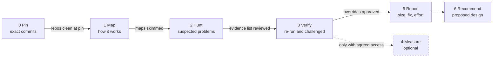

# Kickoff deck outline

An outline for the slides that present a finished audit to the team. Build them in any tool. Every number on a slide is copied from the README, the report, the verification log or the run log, never retyped from memory; the deck is the one hand-made deliverable, so it is the one most likely to drift.

## Audience rule

The room is mixed: managers and product people next to engineers. So:

- **Headlines and slide text are plain:** what fails, from what size, what customers or operators see. No finding ids, commit hashes, agent types or model names on the slide face.
- **Ids, commits, models and file paths go in the speaker notes and the appendix**, where an engineer can check them.
- **Write each severity out in words**; colour may support it but must not carry it alone.
- Every slide that shows a breaking size says "calculated" unless a measurement backs it.

## Main slides

| # | Slide | Headline shape | Content |
|---|---|---|---|
| 1 | Cover | The audit question, as a question | One sentence on how the audit worked; the pin date; what is out of scope |
| 2 | Goal and scope | One question, what was read, what was not | Repos and versions in plain words; out-of-scope list |
| 3 | The answer | "Yes", "Not yet — here is what breaks first", or "Yes, after these changes" | Two sentences of why; chart 1 (severity bars) |
| 4 | What fails first | "N problems already fail at <smallest tier>" | Chart 2 (breaking-size ladder) |
| 5 | The worst problems | What breaks first | A short table: what fails, from about which size, what people see |
| 6 | Why it breaks | The few patterns behind most problems | Two to four plain boxes, each ending with what users see |
| 7 | Where the risk sits | Which parts of the system carry most risk | Module or area table, or the heatmap from the recommendations |
| 8 | How the audit ran | Seven steps (0–6), each behind a check | The pipeline diagram below |
| 9 | Who did the work | Agents per phase | Chart 3 (agents per phase), from the run log only |
| 10 | How far to trust it | Suspected in, confirmed out | Chart 4 (verification funnel); "overrides removed, merged or held back, never added" |
| 11 | Proposed design | Today versus proposed; the team decides | A current-versus-target picture keyed to the decision records |
| 12 | Order of work | What to do now, next, later | Plain list with effort S, M, L |
| 13 | Still unknown | Sizes are calculated, not measured | What access would measure them; never production load |
| 14 | Decisions needed today | The asks, numbered | Owners for "now" items; yes, no or a date for each proposed decision; access for measuring |
| 15 | What you get | One folder, the shared pages, and the tracker for status | Deliverables table: what, for whom, where |

## Appendix

| # | Slide | Content |
|---|---|---|
| A1 | How the audit ran, step by step (1 of 2) | Pin, map, hunt, verify: inputs, outputs, gate |
| A2 | How the audit ran, step by step (2 of 2) | Measure, report, recommend; the guardrails (read-only, deny rules, stop rule) |
| A3 | Agents, methods and tools | Three columns: what · used for · the record that proves it. Then "installed or planned, not used" and "not claimed" |
| A4 | The proposed changes | One row per decision record: today, proposed, what it means for users, findings it closes |
| A5 | Glossary | Every term used in the deck, in plain words |

## The four charts

1. **Severity bars:** one horizontal bar per severity level, most severe at the top, the word and the count printed beside each bar. Not one stacked bar.
2. **Breaking-size ladder:** one horizontal bar per tier ("at any size", then each tier of the config, then "above target", "grows without a hard break", "not size-driven"), with the count of the most severe level printed beside each bar.
3. **Agents per phase:** one bar per phase, labelled with the roles in plain words (mappers, hunters, rule writer, skeptics, verifier, architects, docs writer). Counts from `work/run-log.json` only; a phase with no recorded count says "not recorded".
4. **Verification funnel:** stepped bars from candidates, through re-run evidence and skeptic review, to reported findings, with small tiles for refuted, merged, held and out of scope. Counts from the verification log.

Chart rules: bars in one accent colour; a second segment is an outline, not a second colour; labels are text beside the bars, not inside them.

## Pipeline diagram

Six boxes in one row, left to right, with the gate written under each arrow; Measure sits below as a dashed box because it is optional.

## Must not claim

Each item below is a way a deck can say more than the records support. Check every slide against it.

- **A tool, plugin, skill or server by name unless a work file shows it ran.** "Installed" and "planned" are not "used". If a method was borrowed but its tool was not run, name the method, not the tool.
- **A model, effort or agent type for a phase the run log does not record.** Write "not recorded".
- **A total you did not count.** Say "more than N" only if the files show at least N.
- **"Survived" or "approved by" reviewers.** Findings were "challenged by" skeptics; say what the votes were.
- **A measured number when nothing was measured,** or "proven" for a PROVEN-STATIC finding.
- **How many agents ran at once,** unless a setting or record shows it.
- **Hours, days, money or dates for the fixes** that nobody estimated.
- **That the system is secure, or the code clean:** the audit did not look.
- **That the proposed design is decided:** it is proposed until the team says otherwise.
