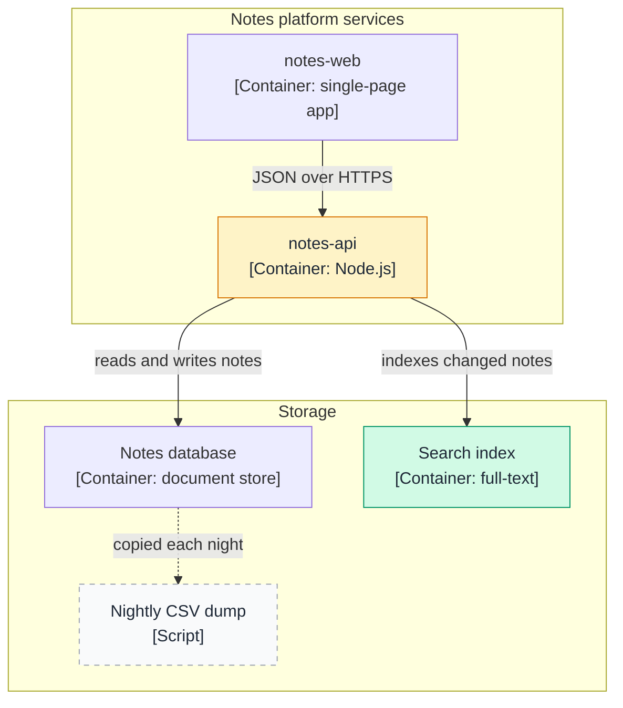
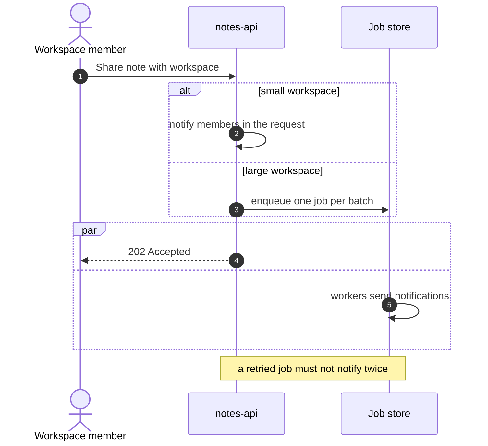
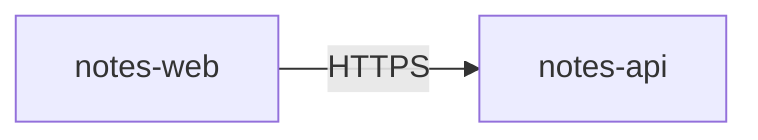
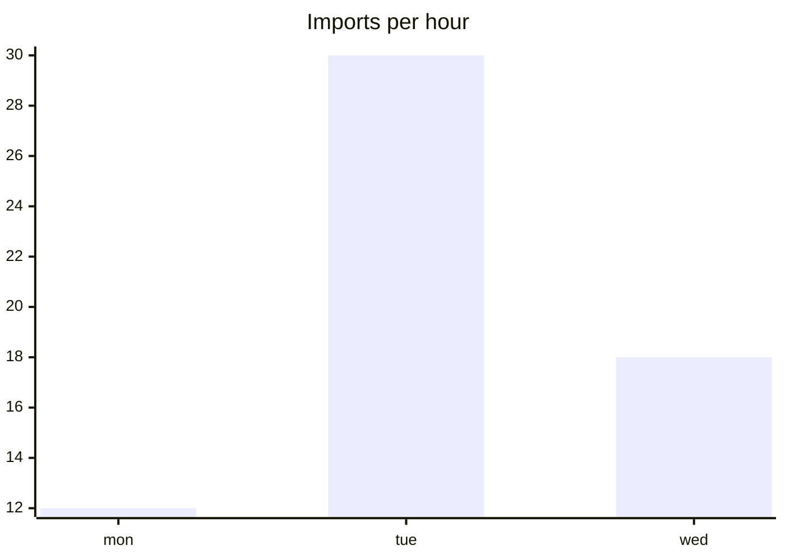

# Render test (once per docs host, about five minutes)

**Why:** the system docs and the recommendations use Mermaid diagrams, emoji tables and alert boxes. Hosts render them with their own bundled Mermaid version, and a local editor preview may differ. The host's own preview is the authority, so check it once before the team reads the docs there.

**How:** on GitHub, paste everything below the line into a new private gist or into the preview tab while editing any file; on GitLab, use a private snippet, or open a file for editing and switch to its preview. Nothing has to be committed. Note pass or fail for each row.

| # | Test | Pass means |
|---|---|---|
| 1 | Mermaid `info` block | A version number is shown; write it down |
| 2 | Flowchart with two subgraphs, quoted labels, three `classDef` classes and a `<br/>` | It renders; three box styles are visible (changed, new, removed dashed); `<br/>` is a line break, not text |
| 3 | Sequence diagram with `autonumber`, `alt`, `par` and `Note over` | It renders with step numbers |
| 4 | A table with emoji squares and a `[!NOTE]` alert | Emoji show; the alert box has its own style (a plain quote is acceptable) |
| 5 | Optional: the flowchart from test 2 with YAML front matter | Information only: if it renders, front matter could be allowed later |
| 6 | Optional: an `xychart-beta` block | Information only; the kit's docs do not use it |
| 7 | Later, once the workspace files are in a repository: open the report and the verification log in the file view, and click one anchor link into each | Both files render in full (not "file too large"); the anchors jump to the right heading |

If test 2 or 3 fails, keep diagrams to what passed and tell whoever builds the docs.

---

**Test 1: which Mermaid**

```mermaid
info
```

**Test 2: classes and line breaks in a flowchart**



**Test 3: a sequence with numbered steps**



**Test 4: emoji cells and an alert box**

| Module | Critical | High | Medium |
|---|---|---|---|
| imports | 🟥 | 🟧 | · |
| notifications | · | 🟧 | 🟨 |
| search | · | · | 🟨 |

> [!NOTE]
> This box should look different from an ordinary quote.

**Test 5 (optional): front matter**



**Test 6 (optional): a beta chart**


