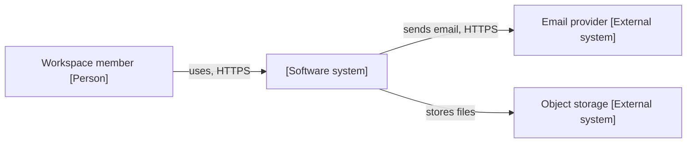
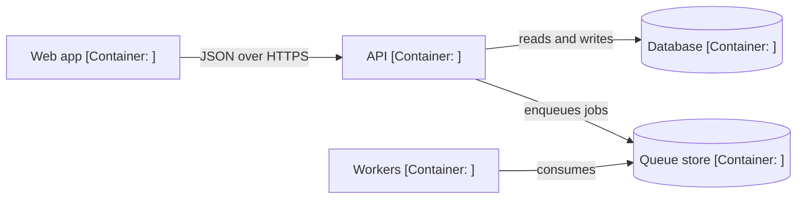

# <system name>: platform overview

<!-- The entry page of system-docs/: put it at
     system-docs/platform-overview.md. One context picture, one container
     picture, and a short guide to the per-repo pages. Describe the system as
     it is at the pinned commits; the proposed design belongs on the target
     architecture page that the recommend step builds.

     arc42 mapping (no renamed files): Context = arc42 section 3; Containers
     and Repos = building blocks level 1 (section 5); Deployment = section 7
     (or a link to the infrastructure page); Cross-cutting = section 8.
     Per-repo architecture pages = building blocks level 2; request-flow and
     background-job pages = runtime view (section 6); the audit report and the
     recommendations = risks and technical debt (section 11).

     Diagram rules: Mermaid flowchart or sequenceDiagram only; C4-style names
     at context and container level only; every node label quoted, with its
     technology; every arrow labelled. Check them once in the docs host's own
     preview (templates/render-test.md). -->

**Pinned at:** <repo@short, one per repo> · **Written:** <YYYY-MM-DD>

## Context

<Who uses the system and which outside systems it depends on, in three or four sentences.>

## Containers

| Container | Repo | Technology | Page |
|---|---|---|---|
| <name> | `<repo>` | <...> | `<repo>/architecture.md` |

## Deployment

<Where each container runs; a link to the infrastructure page if there is one.>

## Cross-cutting

<Authentication between services, configuration sources, logging, shared libraries: one line each with a link to the detail.>

## Reading guide

| If you want to know | Read |
|---|---|
| How one service is built | `<repo>/architecture.md` |
| What happens when a user does X | `<repo>/request-flows.md` |
| What runs in the background | `<repo>/background-jobs.md` |
| What the audit proposes to change | the target architecture page and the recommendations |
