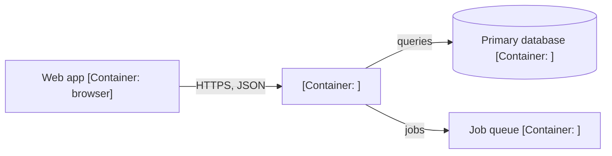

# <repo>: how it works today (backend)

<!-- Outline for one backend repo's system docs, written from the Phase 1
     map. Put it at system-docs/<repo>/architecture.md; when a section grows
     long, move it into its own page next to it (data-model.md,
     background-jobs.md, request-flows.md, configuration.md) and leave a
     link. Every fact cites <repo>@<short>:path:line at the pinned commit;
     anything not checked is marked UNVERIFIED. Describe; do not judge:
     problems belong in the audit report, not here.

     arc42 mapping: Overview and Modules = building blocks (level 2);
     Request flows and Background jobs = runtime view; Configuration =
     cross-cutting concepts; Data model = part of the building blocks. -->

**Pinned at:** `<repo>@<short>` · **Role:** backend · **Mapped:** <YYYY-MM-DD>

## Overview

<Two or three sentences: what this service is for, who calls it, what it calls. Framework and runtime with versions from the lockfile.>

## Modules

| Module | Folder | Responsibility | Talks to |
|---|---|---|---|
| <name> | `src/modules/<name>/` | <one line> | <modules, stores, services> |

## Entry points

- **HTTP routes:** <prefix, how routes are registered, body and rate limits, CORS>
- **Queue consumers:** <queue name, handler, concurrency, retries and back-off, what happens to failed jobs>
- **Scheduled jobs:** <schedule, what each selects, how it records progress, whether two runs can overlap>
- **Event listeners and start-up hooks:** <...>

## Data model

| Collection or table | Owner module | Fields that grow with the size unit | Indexes declared in code | Retention |
|---|---|---|---|---|
| <name> | <module> | <arrays, counters, nested lists> | <fields> | <TTL or none> |

## Background jobs

<For each job: producer, consumer, payload size, idempotency (what a second run does), and how a restart mid-run is handled.>

## Request flows

<The heavy flows end to end, each as a short numbered list or a sequence diagram: what is read, what is written, what is called, and what grows with the size unit.>

## Configuration

| Setting | Where it is read | Default | What it controls |
|---|---|---|---|
| `<ENV_VARIABLE_NAME>` | `<path:line>` | <value or none> | <...> |

Environment variable **names** only, never their values.

## Outside services

| Service | Client | Timeout | Retries | Notes |
|---|---|---|---|---|
| <name> | `<path>` | <value or "none set"> | <...> | <...> |

## Not covered

<What the map could not see: generated code, private packages, settings that live outside the repo.>
