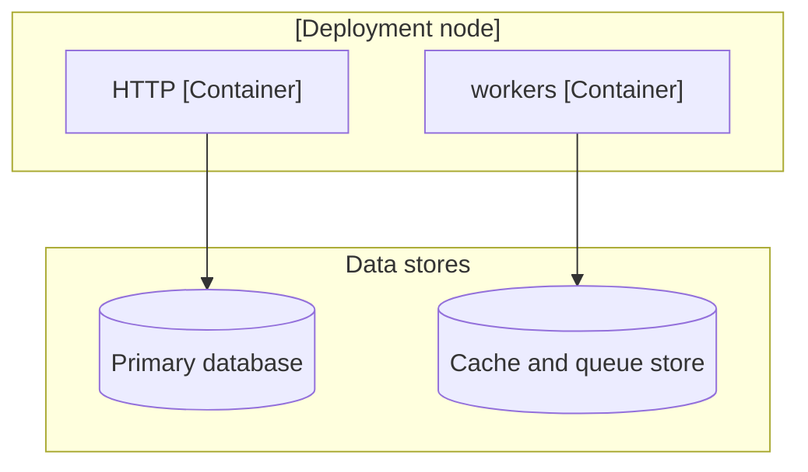

# <repo>: how it runs (infrastructure)

<!-- Outline for one infrastructure repo (deployment manifests, infrastructure
     as code, monitoring), often marked context_only in the config. Put it at
     system-docs/<repo>/architecture.md. Every fact cites
     <repo>@<short>:path:line at the pinned commit; values that are set
     outside the repo (a hosting console, a secret store) are marked as such.
     Describe; do not judge.

     arc42 mapping: this page is the deployment view; Limits and Scaling feed
     the cross-cutting concepts. -->

**Pinned at:** `<repo>@<short>` · **Role:** infrastructure · **Mapped:** <YYYY-MM-DD>

## Deployment

| Workload | Replicas | CPU and memory limits | Probes | Shutdown grace |
|---|---|---|---|---|
| <name> | <fixed or min-max> | <...> | <readiness, liveness> | <...> |

## Limits

<Request body and header limits, idle and request timeouts at each hop (edge, load balancer, ingress, service), connection pool sizes. These are candidates for `known_limits` in the config.>

## Scaling

<What scales automatically and on what signal; what is fixed; what shares one instance across environments.>

## Data stores

| Store | Kind | Size or tier | Eviction or retention | Shared with |
|---|---|---|---|---|
| <name> | <...> | <...> | <...> | <other environments or services> |

## Observability

<Dashboards, alerts and logs defined here, and which of the audit's breaking points they would show.>

## Not in this repo

<Settings known to live elsewhere; say where if known.>
